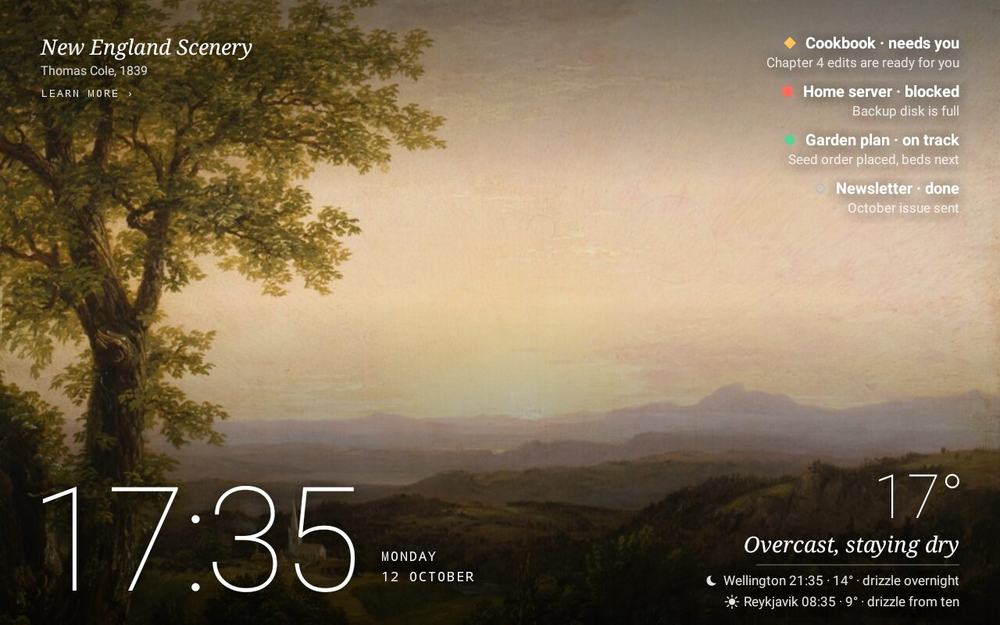
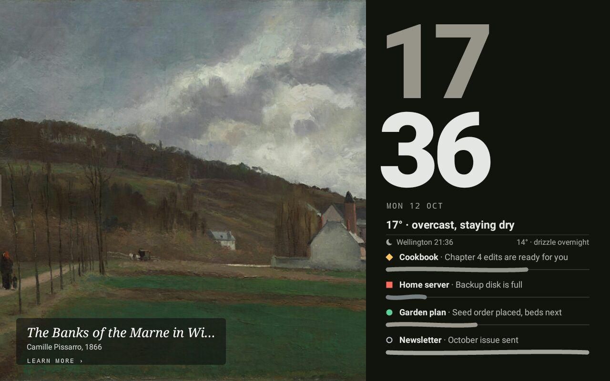
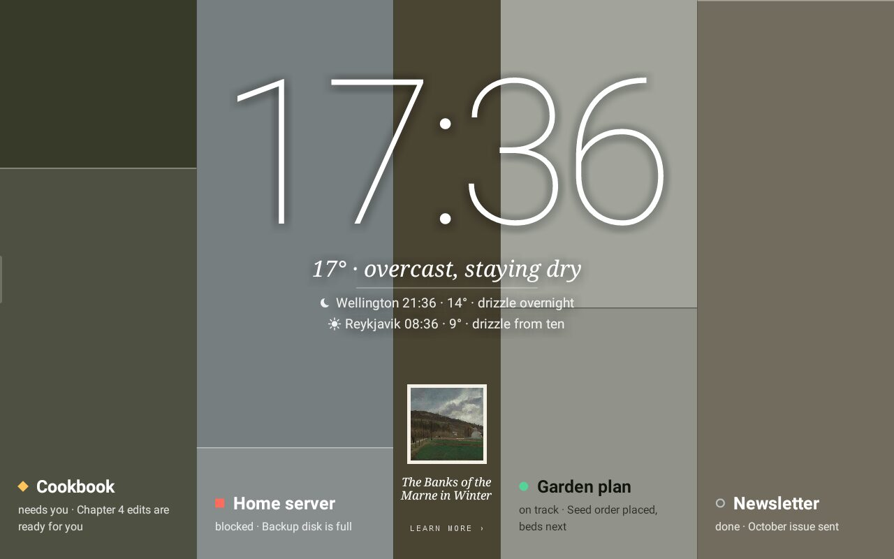
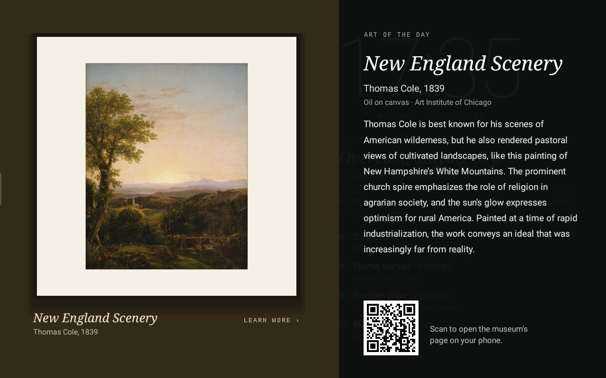
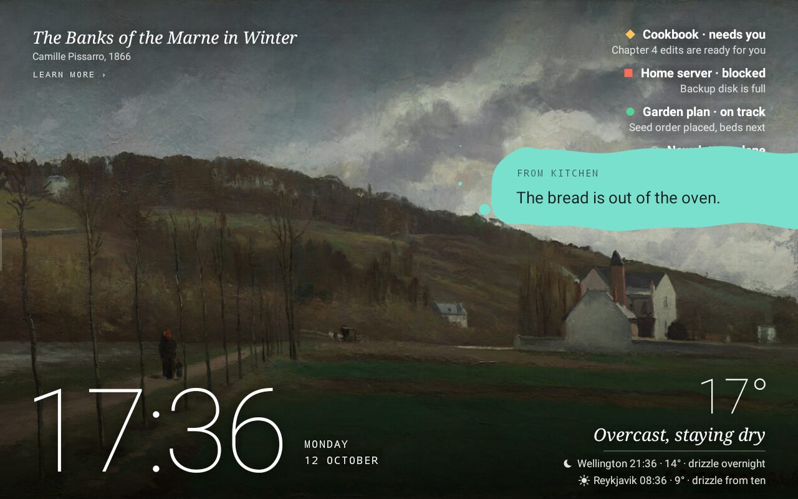
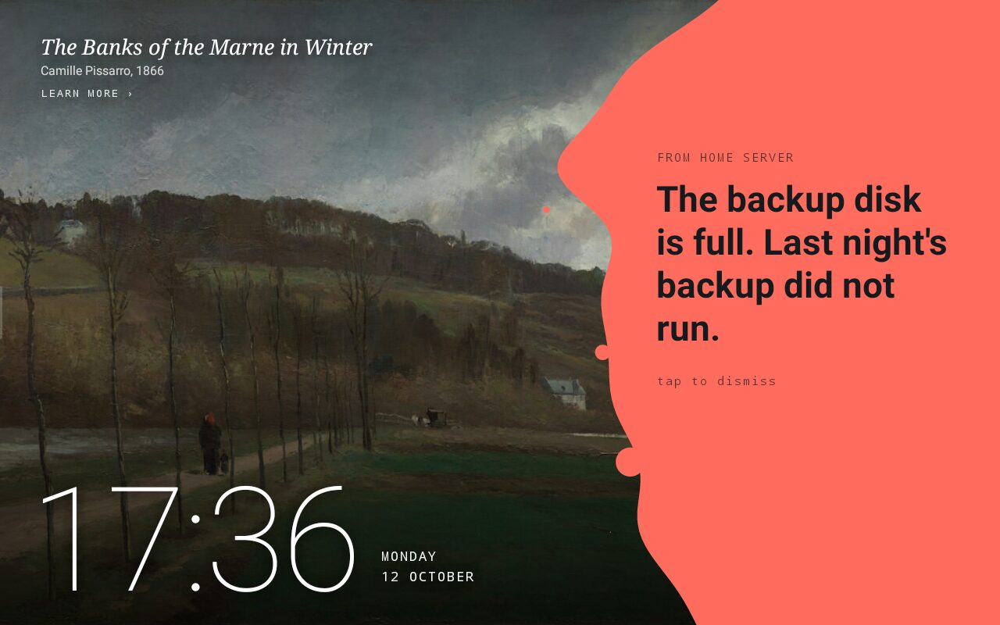

# Mado

Mado (窓, "window") turns an old Android photo frame into a display your other machines and
agents can send things to. It is not a browser kiosk: the frame runs a small native app, so
it stays smooth on very modest hardware.



## What it does

- **A dashboard that is a painting.** Each day the hub picks a public-domain painting from
  the Art Institute of Chicago. The frame shows it with the time, the weather and your
  projects in one of four layouts, all coloured from the painting itself. Tap the label to
  read about it and get a QR code for the museum's page; tap elsewhere for the next layout.
- **Weather in a sentence.** "Rain easing by three", with the temperature and sunset. Other
  places you care about get a line each, with their local time. The frame fetches forecasts
  itself, so weather keeps working when the hub is down.
- **Project status from your agents.** An agent reports where a project stands and the
  dashboard keeps the latest word on each.
- **Liquid alerts.** Anything on your network can put a message on the glass: a *whisper*
  (a bead at the edge), a *nudge* (one line that drains away) or *urgent* (stays until
  someone taps it).
- **Now playing.** The cover of whatever Apple Music or Spotify is playing on your Mac takes
  over the screen while music plays. A small menu bar app on the Mac does the reporting. Tap the cover to fill the screen with it; tap the text to play or
  pause.
- **MCP and HTTP.** Agents get tools; scripts get plain endpoints.
- **The rail.** Tap or swipe the left edge for scenes, brightness and the way back to the
  launcher.

| | |
|---|---|
|  |  |
|  |  |



Planned: Tama (a small on-screen companion), canvases that agents can draw on, night mode.

## How it fits together

```
 senders                         hub                          frame
 ───────                         ───                          ─────
 Mac menu bar app ─────────┐
 agents over MCP ──────────┼──▶  mado-hub  ◀── one socket ──  Mado app
 curl, scripts, cron ──────┘     (Rust)       frame dials out (Kotlin)
```

| Folder | What it is |
|---|---|
| `hub/` | `mado-hub`, the brain. Rust. Serves the frame's WebSocket, an HTTP API, MCP, and a web page where all configuration lives. Runs on a home server (Docker or not) or on a Mac. |
| `frame-app/` | The Android app that draws everything. Kotlin, plain Canvas views, `minSdk 23`. |
| `mac/` | Mado for Mac, a menu bar app that reports what Apple Music or Spotify is playing. Swift. |

The frame holds no secrets and listens on no ports: it opens one outbound connection to the
hub and draws what it is told. Its clock and weather keep working when the hub is down.

## Setting it up

**With an agent:** point your coding agent at
[docs/agent-setup.md](docs/agent-setup.md). It covers checking the device, building,
installing, starting at power-on and wiring up MCP, and it says what the agent must ask you
before doing.

**By hand**, the short version:

1. **The hub**, on any machine the frame can reach:

   ```sh
   docker compose up -d --build        # or: cd hub && cargo run --release
   ```

   It listens on port 7878 (`MADO_BIND`) and keeps its settings in `./data` (`MADO_DATA`).
   Open `http://HOST:7878/` for the web page.

2. **The frame app.** With the frame connected over USB and `adb` working:

   ```sh
   cd frame-app && ./run.sh ws://HOST:7878/frame
   ```

   The hub address is remembered. Put machine-specific setup such as `JAVA_HOME` or
   `ANDROID_SERIAL` in `frame-app/env.local.sh`.

3. **The menu bar app** (optional), on the Mac with the music. It needs Xcode and
   [XcodeGen](https://github.com/yonaskolb/XcodeGen):

   ```sh
   cd mac && scripts/build.sh install
   ```

   Choose "Hub Address…" from its menu and enter the hub's address. macOS asks once for
   permission to control Music or Spotify; the app never launches either. The menu also has
   a switch for each player, one to pause sharing, and "Start at Login".

You need `adb` access to the frame. For most photo frames that means rooting it first, which
depends on the device and is not covered here.

## Talking to the hub

The hub speaks both plain HTTP and MCP; they do the same things.

```sh
curl -X POST http://HOST:7878/api/notify \
  -H 'content-type: application/json' \
  -d '{"text": "Backup finished", "level": "nudge", "source": "nas"}'
```

| HTTP | |
|---|---|
| `POST /api/notify` | `text`, optional `level` (`whisper`, `nudge`, `urgent`), `source`, `ttl_s` (urgent ignores it and stays until tapped) |
| `POST /api/project` | `name`, `status` (`on_track`, `needs_you`, `blocked`, `done`, `archived`), optional `note`, `progress` 0 to 1 |
| `GET /api/look` | JPEG of what the frame is showing |
| `GET /api/state` | Connected frames, now playing, today's painting, projects, config, recent activity |
| `POST /api/now_playing` | What a player is doing: `state` (`playing`, `paused`, `stopped`), `title`, `artist`, `album`, `source`, `position_s`, `duration_s`, and `art_b64` (the cover, JPEG or PNG) when the track changes. Repeat it at least every 30 seconds while playing. |

| MCP tool | |
|---|---|
| `frame_notify` | Show an alert |
| `frame_project` | Report where a project stands |
| `frame_look` | Get a picture of the frame's screen, so an agent can see its own work |
| `frame_state` | The same as `GET /api/state` |

The MCP endpoint is `http://HOST:7878/mcp` (streamable HTTP). For Claude Code:

```sh
claude mcp add --transport http mado http://HOST:7878/mcp
```

## Security

The hub has no authentication. Run it where only your own devices can reach it, for example
bound to a [Tailscale](https://tailscale.com) address, and never expose it to the internet.
The frame does not need to be on the tailnet; it only needs to reach the hub.

If the frame sits on a network you would rather not open the whole hub to, set
`MADO_FRAME_BIND` (for example `0.0.0.0:7879`). The hub then opens a second port that serves
only the frame's socket and the images it fetches, and you can keep the main port, with the
web page, API and MCP, somewhere private. Point the frame at the second port. Anything that
can reach that port can pose as a frame and read what a frame is sent (alerts, projects,
weather places), but cannot send or change anything.

## Hardware

Developed on a Uhale 102KZ: Rockchip RK3126, Mali-400, 1 GB RAM, Android 6.0.1, 1280×800.
The app targets that class of device: no Compose, no large frameworks, and images are
resized on the hub so the frame only has to draw them. Layouts currently assume a 1280×800
landscape screen.

## Development

```sh
cd hub && cargo test                          # hub
cd frame-app && ./gradlew testDebugUnitTest   # forecast wording
cd mac && scripts/build.sh test               # menu bar app
```

`cargo fmt` and `cargo clippy` are expected to be clean. To sign the Mac app with your own
Developer ID and notarize it, see `mac/Signing.xcconfig` and `mac/scripts/notarize.sh`. See [CHANGELOG.md](CHANGELOG.md)
for what changed.

## Credits

Paintings and their descriptions come from the
[Art Institute of Chicago's public API](https://api.artic.edu/docs/); only works it marks as
public domain are used. Forecasts and city search come from
[Open-Meteo](https://open-meteo.com). Album artwork that Music does not have locally is
looked up in the iTunes catalogue.

## Licence

[MIT](LICENSE). The paintings shown are in the public domain; Mado's licence covers the
software, not the artwork or the museum's descriptions.
