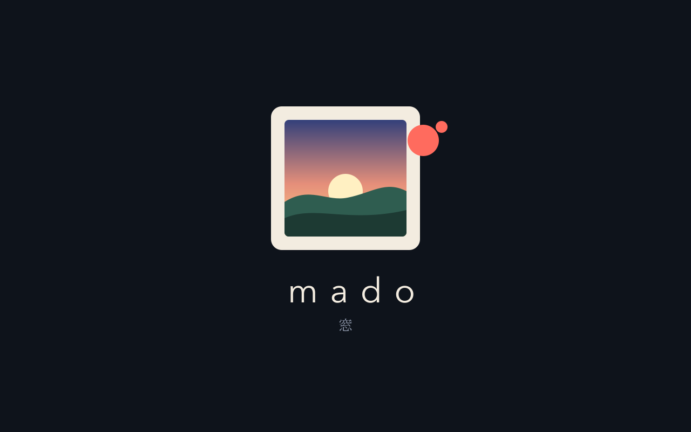

# Replacing the boot splash

A frame shows two pictures while it starts, and both are the vendor's:

1. **The power-on logo**, drawn by the bootloader in the first seconds.
2. **The Android boot animation**, shown from then until the home app appears.

This page replaces both with Mado's, so the frame shows one still picture from power-on
until Mado is on screen. It needs root. Make Mado the home app first
([agent-setup.md](agent-setup.md), step 5), or the launcher will show after the splash.



The picture is `assets/splash.png`, drawn from `assets/splash.svg`. `assets/splash.py` turns
it into the two files a frame needs; it needs Python 3 and ImageMagick. To use your own
picture, pass `--image FILE` (and `--background '#rrggbb'` for the colour around it) before
the subcommand.

If you are an agent: both parts write to system storage, so the ground rules in
[agent-setup.md](agent-setup.md) apply. Say what you are about to write and what the way
back is, and wait for the owner's yes, separately for each part. Part 2 can leave a frame
that does not start.

## Part 1: the boot animation

This is ordinary Android and works on any rooted frame.

```sh
adb shell wm size                                   # the frame's screen, for --size
adb pull /system/media/bootanimation.zip stock-bootanimation.zip    # the way back
assets/splash.py bootanimation bootanimation.zip --size 1280x800
adb push bootanimation.zip /data/local/tmp/
adb shell su -c 'mount -o rw,remount /system && cp /data/local/tmp/bootanimation.zip /system/media/bootanimation.zip && chmod 644 /system/media/bootanimation.zip; sync; mount -o ro,remount /system'
adb shell rm /data/local/tmp/bootanimation.zip
```

Keep `stock-bootanimation.zip` somewhere outside the repository. If the pull finds no file,
look in `/oem/media/` and `/data/local/`; some vendors keep it there, and the copy has to go
to the place the frame actually reads.

Check it without waiting for the next power cut: `adb reboot`, and take a picture of the
screen while `adb shell getprop init.svc.bootanim` says `running`
(`adb exec-out screencap -p > boot.png`).

If the frame came with a helper that keeps remounting `/system` (some rooted frames run a
`su` daemon that does), stop it before writing and confirm `/system` is read-only afterwards.

## Part 2: the power-on logo (Rockchip frames)

This part is specific to frames with a Rockchip chip, which keep the logo as `logo.bmp`
inside a `resource` partition. The same partition holds the kernel's device tree, so a
damaged write means the frame does not start, and the only way back is the chip's loader
mode with a copy of the partition. **Do not start without that copy, and without knowing how
to get this frame into loader mode.** On other chips the logo lives somewhere else and this
script does not apply; stop after part 1.

Find the partition and copy it off the frame:

```sh
adb shell su -c 'ls -l /dev/block/platform/*/by-name/resource'      # e.g. -> /dev/block/mmcblk0p3
adb shell su -c 'dd if=/dev/block/platform/*/by-name/resource of=/data/local/tmp/resource.img bs=1048576'
adb pull /data/local/tmp/resource.img resource-stock.img
adb shell su -c 'md5sum /data/local/tmp/resource.img'               # must match: md5 resource-stock.img
```

`resource-stock.img` is the way back. Keep it outside the repository; it is the vendor's.

Build the replacement. The logo is stored the way the panel scans, which on many landscape
frames is portrait, so the picture has to be turned. `--stock-png` saves the vendor's logo
turned back by the same amount: the right `--rotate` is the one that shows it upright.

```sh
assets/splash.py logo resource-stock.img resource-mado.img --rotate 90 --stock-png stock-logo.png
```

The script keeps the vendor's BMP header byte for byte and writes a picture of exactly the
same size, so nothing in the image moves and only the logo's bytes differ. It refuses
anything but a plain 8-bit or 24-bit BMP. It prints the `dd` line that writes just those
blocks. Look at `stock-logo.png` before going on: if it is not the logo you see at power-on,
upright, something is not as this page assumes.

Write it and read it back:

```sh
adb push resource-mado.img /data/local/tmp/
adb shell su -c 'md5sum /data/local/tmp/resource-mado.img'          # must match the local file
adb shell su -c 'dd if=/data/local/tmp/resource-mado.img of=/dev/block/mmcblk0pN bs=512 skip=S seek=S count=C; sync'
adb shell su -c 'echo 3 > /proc/sys/vm/drop_caches; dd if=/dev/block/mmcblk0pN bs=1048576 | md5sum'
adb shell su -c 'rm /data/local/tmp/resource.img /data/local/tmp/resource-mado.img'
```

Use the partition and the `skip`, `seek` and `count` the earlier steps gave you. The last
checksum must equal that of `resource-mado.img`; if it does not, write `resource-stock.img`
back the same way (without `skip`, `seek` and `count`) before rebooting. Old `dd` builds
reject `conv=notrunc`; it is not needed on a block device.

Then reboot. The bootloader's picture cannot be captured over `adb`, so ask the owner to
look at the frame as it powers up.

## Going back

- Boot animation: copy `stock-bootanimation.zip` back as in part 1.
- Logo: write `resource-stock.img` to the `resource` partition with `dd` while the frame
  runs, or from loader mode if it does not start.

Reflashing a full system or resource image from a backup taken before this also brings the
vendor's pictures back.

## Changing the picture

Edit `assets/splash.svg` and draw it again:

```sh
rsvg-convert assets/splash.svg -o assets/splash.png
```

The text is set in Avenir Next and Hiragino Mincho, which come with macOS; on another
system change the fonts in the SVG. Keep the picture dark: the frame shows it at full
brightness whatever the hour, because Mado's own brightness setting has not started yet.
